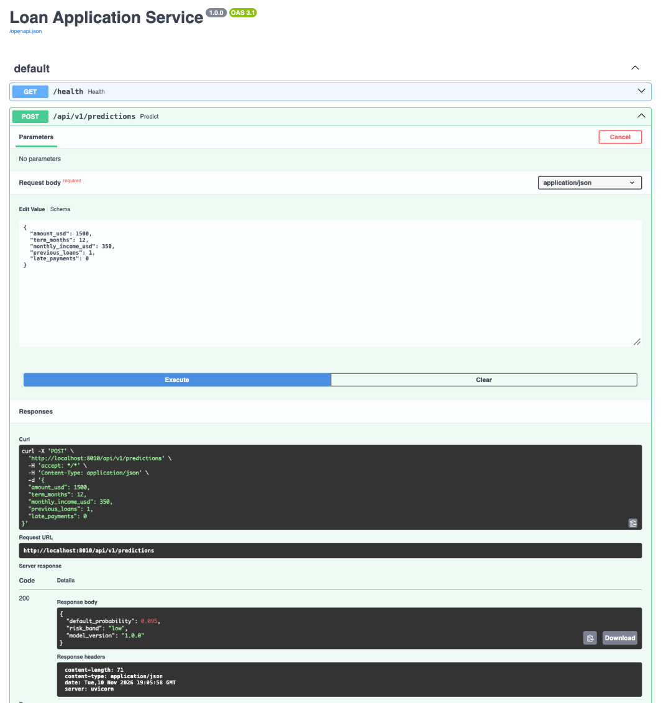

# Production Checklist: loan-api

Evidence for each requirement in the Lesson 4.7 table.

| # | Requirement | Status |
|---|-------------|--------|
| 1 | Multi-stage `Dockerfile.prod`: slim base, non-root user, HEALTHCHECK | Done |
| 2 | `.dockerignore` excludes Git, caches, local models and dev config | Done |
| 3 | Model path configurable with `MODEL_PATH` | Done |
| 4 | `compose.yaml` runs API + PostgreSQL + Adminer, with the API built from `Dockerfile.prod` | Done |
| 5 | Image at least 40% smaller than the full-Python variant | Done (62.9% smaller) |
| 6 | No HIGH or CRITICAL findings without a note explaining them | Done (0 CRITICAL, every HIGH noted) |
| 7 | Image published as `meghoing/loan-api:1.0.0` and `:latest` | Done |

---

## 1. Multi-stage Dockerfile.prod: slim base, non-root user, HEALTHCHECK

File review (`Dockerfile.prod`):

- Two stages: `FROM python:3.12-slim AS builder` installs packages into `/opt/venv` and trains the model; the second `FROM python:3.12-slim` copies in only `/opt/venv`, `model.joblib`, `main.py` and `schemas.py`.
- `useradd --create-home --uid 1000 appuser` and `USER appuser`.
- `HEALTHCHECK` calls `/health` every 30 seconds with Python's `urllib`.

```console
$ docker build -t loan-api:prod -f Dockerfile.prod .
$ docker run -d --name prod -p 8000:8000 loan-api:prod
$ docker exec prod whoami
appuser
$ sleep 35
$ docker ps --filter name=prod
NAMES     IMAGE           STATUS
prod      loan-api:prod   Up 35 seconds (healthy)
$ docker rm -f prod
```

For comparison, the single-stage image runs as root:

```console
$ docker run --rm --entrypoint whoami loan-api:slim
root
```

## 2. .dockerignore excludes Git, caches, local models and dev config

File review (`.dockerignore`):

```text
# Git
.git
.gitignore
# Caches and environments
.venv
__pycache__/
*.pyc
.pytest_cache/
# Dev config
.devcontainer/
.env
.env.*
# Local models
model.joblib
models/
```

The image trains its own model in the builder stage, so no model file from this machine is copied in.
Only the app files and the image-trained model are in `/app`:

```console
$ docker run --rm --entrypoint ls loan-api:prod -la /app
-rw-r--r-- 1 root root 2105 main.py
-rw-r--r-- 1 root root 1940 model.joblib
-rw-r--r-- 1 root root  837 schemas.py
```

## 3. Model path configurable with MODEL_PATH

`main.py` reads `MODEL_PATH = os.getenv("MODEL_PATH", "model.joblib")` and loads it with `joblib.load(MODEL_PATH)`.

Default (model trained inside the image):

```console
$ docker run --rm -p 8000:8000 loan-api:prod
$ curl localhost:8000/health
{"status":"ok","model_version":"1.0.0"}
```

Mounted 1.1.0 model, same image, no rebuild:

```console
$ python train.py --version 1.1.0 --out models/model.joblib
Saved model 1.1.0 to models/model.joblib (test AUC 0.923)

$ docker run --rm -p 8000:8000 \
    -v "$(pwd)/models:/models:ro" \
    -e MODEL_PATH=/models/model.joblib \
    loan-api:prod
$ curl localhost:8000/health
{"status":"ok","model_version":"1.1.0"}
```

## 4. compose.yaml runs API + PostgreSQL + Adminer, with the API built from Dockerfile.prod

`compose.yaml` builds `api` with `context: .` and `dockerfile: Dockerfile.prod`, and runs `db` (`postgres:17`, seeded by `init.sql`) and `adminer` (`adminer:4.8.1`).

```console
$ docker compose up -d --build
$ sleep 35
$ docker compose ps
SERVICE   IMAGE           STATUS
adminer   adminer:4.8.1   Up 40 seconds
api       loan-api-api    Up 35 seconds (healthy)
db        postgres:17     Up 40 seconds (healthy)
```

The API answers, and the seed data is in PostgreSQL:

```console
$ curl -X POST localhost:8000/api/v1/predictions -H 'Content-Type: application/json' \
    -d '{"amount_usd":1500,"term_months":12,"monthly_income_usd":350.0,"previous_loans":1,"late_payments":0}'
{"default_probability":0.095,"risk_band":"low","model_version":"1.0.0"}

$ docker compose exec db psql -U loans -d loans -c "SELECT b.full_name, a.amount_usd, a.term_months, a.status FROM loan_applications a JOIN borrowers b ON b.id = a.borrower_id ORDER BY a.id;"
   full_name    | amount_usd | term_months |  status
----------------+------------+-------------+----------
 Sok Dara       |       1500 |          12 | pending
 Chan Sreyneang |        800 |           6 | approved
 Kim Vuthy      |       3200 |          24 | pending
 Heng Malis     |       2000 |          18 | rejected
 Sok Dara       |        600 |           6 | pending
 Heng Malis     |       1200 |          12 | pending
(6 rows)
```

## 5. Image at least 40% smaller than the full-Python variant

```console
$ sed 's/^FROM python:3.12-slim/FROM python:3.12/' Dockerfile > Dockerfile.full
$ docker build -t loan-api:full -f Dockerfile.full .
$ docker build -t loan-api:slim -f Dockerfile .
$ docker build -t loan-api:prod -f Dockerfile.prod .
$ docker images loan-api
REPOSITORY   TAG       IMAGE ID       SIZE
loan-api     prod      a453c5bb9251   818MB
loan-api     slim      21dabc9050d8   800MB
loan-api     full      76bf3cc66b5c   2.2GB
```

prod is 818 MB against 2,202 MB for full: **62.9% smaller** (required: at least 40%).

## 6. No HIGH or CRITICAL findings without a note explaining them

Scanned with Trivy pinned to `0.69.3` (the version Lesson 4.6 lists as safe after the 2026 Trivy compromise). Full report: [`evidence/trivy-report.txt`](evidence/trivy-report.txt).

```console
$ docker run --rm -v /var/run/docker.sock:/var/run/docker.sock aquasec/trivy:0.69.3 image --severity HIGH,CRITICAL loan-api:prod
```

| Scan | Debian packages | Python packages |
|------|-----------------|-----------------|
| First scan | HIGH 49, CRITICAL 0 | 0 |
| After rebuild | HIGH 47, CRITICAL 0 | 0 |

Notes on each finding:

| CVE | Packages | Fix available | Note |
|-----|----------|---------------|------|
| CVE-2026-76844, CVE-2026-85091 | zlib1g | Yes | **Rebuilt and fixed.** Added `apt-get upgrade` to the runtime stage of `Dockerfile.prod` and rebuilt with `--pull`. No longer reported. |
| CVE-2026-76642, CVE-2026-78408, CVE-2026-78409, CVE-2026-78410 | util-linux, mount, login, bsdutils, libblkid1, libmount1, libsmartcols1, libuuid1, liblastlog2-2 | No | Cannot be fixed yet: Debian has not released a fix. These affect `mount` and `nsenter`; the API never calls them and runs as `appuser` without extra privileges. |
| CVE-2025-69720 | libncursesw6, libtinfo6, ncurses-base, ncurses-bin | No | Cannot be fixed yet. The API has no terminal interface and does not use ncurses. |
| CVE-2026-119373, CVE-2026-119374, CVE-2026-119379 | libsqlite3-0 | No | Cannot be fixed yet. The API does not open SQLite databases. |
| CVE-2026-16742 | libsystemd0, libudev1 | No | Cannot be fixed yet. systemd does not run inside the container. |
| CVE-2026-54369 | libacl1 | No | Cannot be fixed yet. The API does not manage file ACLs. |
| CVE-2026-9538 | perl-base | Deferred by Debian | Cannot be fixed yet. The API never runs Perl or unpacks tar files. |

All remaining findings are in packages that are part of the Debian base image. The `apt-get upgrade` step picks up fixes automatically, so the image will be rebuilt and scanned again when Debian publishes them.

No secrets were found in the image or the repository:

```console
$ trivy image --scanners secret loan-api:prod   -> 0 secrets
$ trivy fs --scanners secret .                  -> 0 secrets
```

The only password in the repository is the development-only database password in `compose.yaml`.

## 7. Image published as meghoing/loan-api:1.0.0 and :latest

Logged in with a Docker Hub access token (`docker login`), then built and pushed both tags. The image is built for `linux/amd64` and `linux/arm64`, so it runs on Codespaces and servers as well as Apple Silicon:

```console
$ DOCKER_USER=meghoing
$ docker buildx build -f Dockerfile.prod --platform linux/amd64,linux/arm64 \
    -t $DOCKER_USER/loan-api:1.0.0 -t $DOCKER_USER/loan-api:latest --push .
```

Docker Hub repository: https://hub.docker.com/r/meghoing/loan-api/tags (tags `1.0.0` and `latest`)

Pull and run from the registry with no local files:

```console
$ docker compose down
$ docker rmi $DOCKER_USER/loan-api:1.0.0 $DOCKER_USER/loan-api:latest loan-api:prod
$ docker run --rm -p 8000:8000 $DOCKER_USER/loan-api:1.0.0
Unable to find image 'meghoing/loan-api:1.0.0' locally
1.0.0: Pulling from meghoing/loan-api
```

`/docs` with the **200** response from `POST /api/v1/predictions`:


